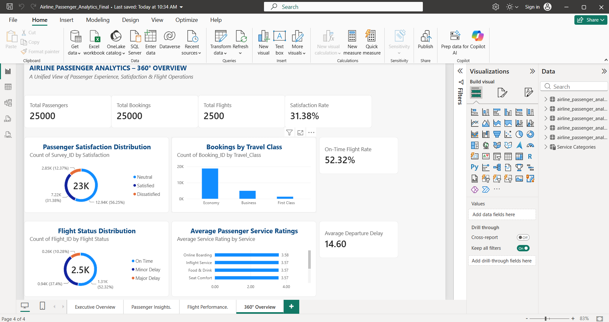
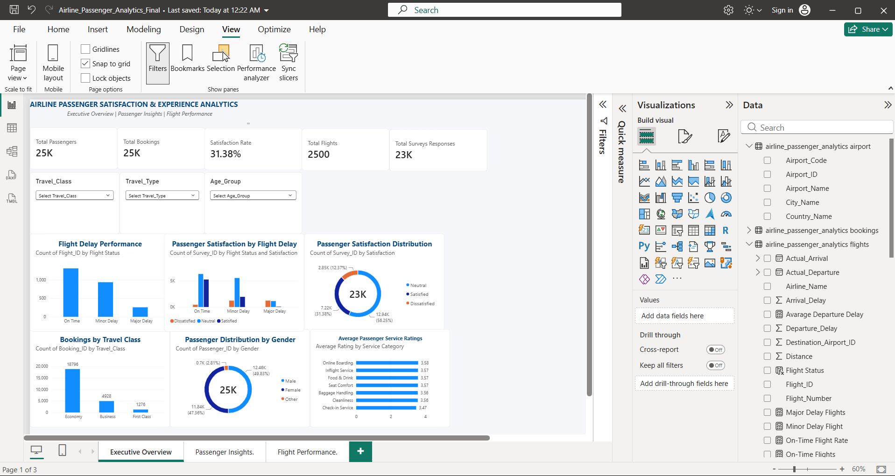
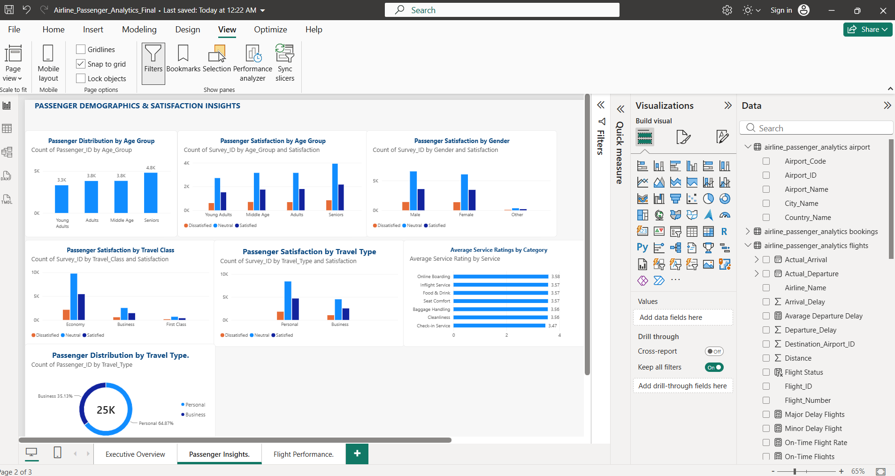
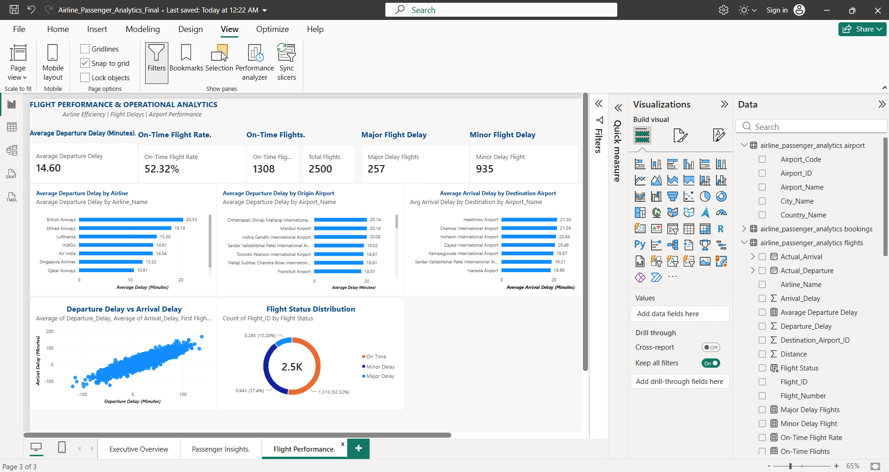

# ✈️ Airline Passenger Satisfaction & Experience Analytics

An end-to-end data analytics project exploring airline passenger satisfaction, service quality, flight delays, and operational performance using **MySQL, Python, SQL, and Microsoft Power BI**.

## 📌 Project Overview

The project analyses synthetic airline passenger, flight, booking, airport, and passenger survey data to understand passenger experience and identify potential areas for operational improvement.

It combines database management, exploratory data analysis, business-focused SQL queries, and interactive Power BI dashboards to provide a comprehensive view of airline performance.

## 🎯 Business Objectives

- Analyse passenger demographics and travel patterns.
- Evaluate passenger satisfaction across different service categories.
- Identify patterns in flight departure and arrival delays.
- Compare flight performance across airlines and airports.
- Understand satisfaction differences across passenger segments.
- Develop data-driven recommendations for improving passenger experience.

## 🛠️ Technology Stack

| Technology | Purpose |
|---|---|
| MySQL | Relational database management |
| SQL | Data extraction and business analysis |
| Python | Data analysis and validation |
| Pandas & NumPy | Data manipulation and processing |
| Matplotlib | Data visualization |
| Microsoft Power BI | Interactive dashboards |
| Excel | Supporting data analysis |
| Git & GitHub | Version control and project documentation |

## 🗄️ Database Architecture

The project uses a relational database named `airline_passenger_analytics`.

Five primary tables:

1. **Airport** – Airport names, codes, cities, and countries.
2. **Passengers** – Passenger demographic information.
3. **Flights** – Flight schedules, airline details, and delay information.
4. **Bookings** – Passenger bookings, travel dates, and travel classes.
5. **passenger_surveys** – Passenger ratings and satisfaction information.

The database contains approximately 85,530 records across five tables.

## 📊 Dataset Overview

| Dataset | Records |
|---|---:|
| Airports | 30 |
| Passengers | 25,000 |
| Flights | 2,500 |
| Bookings | 25,000 |
| Passenger Surveys | 23,000 |
| **Total** | **85,530** |

**Note:** All datasets used in this project are synthetically generated for educational and analytical purposes. They do not represent actual airline transactions or passenger feedback.

## 🐍 Python Exploratory Data Analysis

Python was used to perform:

- Database connectivity and data extraction.
- Data quality validation.
- Missing-value and duplicate checks.
- Univariate and bivariate analysis.
- Passenger demographic analysis.
- Flight delay analysis.
- Passenger satisfaction analysis.
- Data visualization and statistical exploration.

Key Python libraries: Pandas, NumPy, Matplotlib, SQLAlchemy, and PyMySQL.

## 🧮 SQL Business Analysis

SQL was used to perform business-oriented analysis, including:

- Passenger and booking summaries.
- Flight performance and delay categorization.
- Airline and airport performance comparisons.
- Passenger satisfaction analysis.
- Service rating comparisons.
- Aggregations, filtering, joins, CASE expressions, and Common Table Expressions (CTEs).

## 📈 Power BI Dashboards

The project includes four interactive report pages.

### 1. 360° Airline Analytics Overview
A consolidated executive dashboard presenting passenger volumes, bookings, flight performance, satisfaction, and service quality.

### 2. Executive Overview
A high-level summary of passenger demographics, satisfaction distribution, travel class, and service ratings.

### 3. Passenger Insights
An analysis of passenger age groups, gender, travel class, travel type, and satisfaction patterns.

### 4. Flight Performance
An operational analysis covering airline delays, origin and destination airport performance, flight status distribution, and departure-versus-arrival delay relationships.

## Power BI Dashboard Screenshots

### 1. 360° Overview


### 2. Executive Overview


### 3. Passenger Insights


### 4. Flight Performance


## Power BI Dashboard Screenshots

### 1. 360° Overview


### 2. Executive Overview


### 3. Passenger Insights


### 4. Flight Performance


## 🔍 Key Analytical Findings

- The dataset contains 25,000 passengers and 25,000 bookings.
- The survey dataset contains 23,000 responses.
- Overall passenger satisfaction rate: 31.38%.
- On-time flight rate: 52.32%, using the project's threshold of departure delay up to 15 minutes.
- Average departure delay: approximately 14.60 minutes.
- Departure and arrival delays show a strong positive correlation in the synthetic dataset.

These findings are descriptive results from the generated dataset and should not be interpreted as actual airline industry performance.

## 💡 Business Recommendations

Based on the analytical patterns, potential areas for improvement include:

- Investigating operational factors associated with major flight delays.
- Monitoring airport-level departure and arrival performance.
- Reviewing passenger feedback on check-in and baggage handling services.
- Evaluating service quality across different passenger segments.
- Monitoring satisfaction and operational KPIs through interactive dashboards.

## 📁 Project Structure

```text
airline-passenger-analytics/
│
├── analysis/           # Python exploratory analysis scripts
├── data/
│   ├── raw/            # Original datasets
│   └── processed/      # Processed datasets
├── scripts/            # Data generation and loading scripts
├── sql/                # Database schema and SQL queries
├── notebooks/          # Jupyter notebooks
├── visualizations/     # Dashboard screenshots and charts
├── powerbi/             # Power BI report
│
├── .gitignore
└── README.md
```

## 🚀 Getting Started

### Prerequisites

- Python 3.x
- MySQL Server
- MySQL Workbench
- Microsoft Power BI Desktop
- Git

### Setup

1. Clone the repository:

```bash
git clone https://github.com/Moulali-7ai/airline-passenger-analytics.git
```

2. Navigate to the project directory:

```bash
cd airline-passenger-analytics
```

3. Install the required Python libraries:

```bash
pip install pandas numpy matplotlib sqlalchemy pymysql
```

4. Create the MySQL database and execute the SQL schema script available in the `sql/` directory.

5. Configure your local MySQL connection and execute the Python scripts.

**Security:** Database credentials should be entered securely at runtime or configured through environment variables. Never commit actual passwords or private credentials.

6. Open the `.pbix` report in Microsoft Power BI Desktop.

## 👨‍💻 Author

**Moulali**

Data Analytics | SQL | Python | MySQL | Power BI

GitHub: [Moulali-7ai](https://github.com/Moulali-7ai)

---

*This project was developed as a hands-on data analytics portfolio project to demonstrate database management, data analysis, visualization, and business problem-solving skills.*
